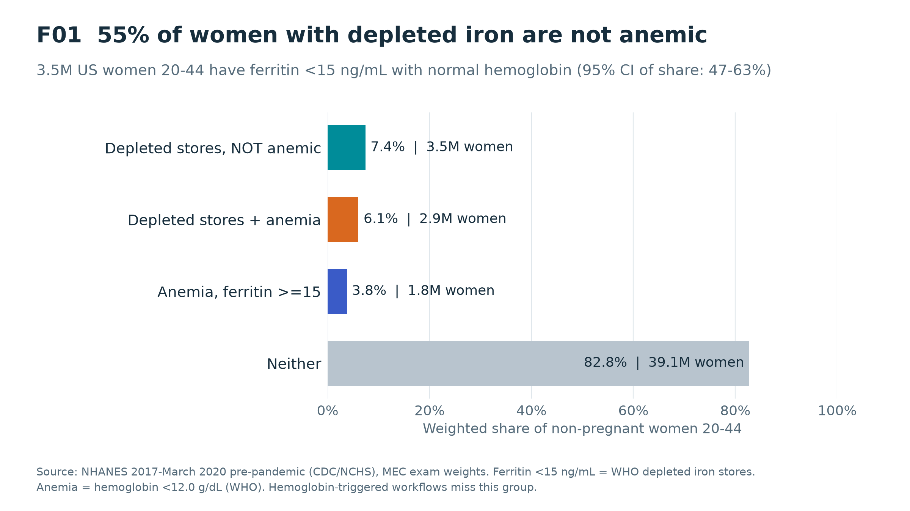

# Iron-Status Diagnostic: Market Access & Customer-Fit Analytics

**Which populations need an at-home iron-status test, where does today's care pathway miss them, and
which launch channel should come first?**

An end-to-end analysis built with SQL (DuckDB) and Python. It combines real national survey and lab
data with a synthetic EHR, then produces a clinical-style Tables/Figures/Listings (TFL) package and a
results deck.



## Headline results

| | |
|---|---|
| **13.5%** | of non-pregnant US women 20–44 have depleted iron stores (ferritin <15 ng/mL) |
| **55%** of them | are **not anemic** (95% CI 47.5–62.5%), about **3.5M women** that hemoglobin-first workflows miss |
| **15–17%** | prevalence in menstruating and lower-income women, vs **1%** in men |
| **27%** | of lower-income women are uninsured, the only segment combining high need with weak coverage |
| **2.5x** | growth in the addressable group if the cutoff moves from 15 to 30 ng/mL |
| **97%** | of synthetic target-condition encounters occur in ambulatory or wellness visits |

**Recommended decision:** launch as a direct-to-consumer *screen-and-refer* product for menstruating
women 18–49, entering through athletes and highly active women. They have the same prevalence, their
deficiency is more often non-anemic, and they are the most able to pay. The product includes a built-in
confirmatory-lab hand-off. Treat pregnancy, CKD and heart failure as
later, clinician-supervised indications. Set the ferritin cutoff on validated assay accuracy, not on
market size.
Full write-up: **[docs/results_and_recommendations.md](docs/results_and_recommendations.md)**.

## Data

| Source | Type | Used for |
|---|---|---|
| [NHANES 2017–Mar 2020](https://wwwn.cdc.gov/nchs/nhanes/continuousnhanes/default.aspx?Cycle=2017-2020) (CDC) | Real, measured labs + questionnaires, survey-weighted | Prevalence, low ferritin without anemia, need vs access |
| [MEPS 2023](https://meps.ahrq.gov/) HC-251 + HC-249 (AHRQ) | Real, national survey, person-weighted | Utilization, insurance, out-of-pocket burden, access barriers |
| [Synthea sample data](https://synthetichealth.github.io/synthea/) (Apr 2020) | Fully synthetic EHR | Code-level patient journey and workflow placement |

Sources are never linked at the person level. Synthea facility, clinician and commercial-payer names
are replaced with pseudonyms at import.

## Methods highlights

- **22-step SQL pipeline** (`sql/`), layered `raw → analytics → mart`, with explicit grain checks. Every
  embedded `PASS/REVIEW` check acts as an assertion, and the build stops on any failure (Listing L03).
- **Survey-correct estimation:** MEC/person weights throughout, plus design-based 95% CIs (Taylor
  linearization over strata/PSUs, domain estimation) for headline NHANES estimates. Python estimates
  are asserted against the SQL marts.
- **Clinically grounded definitions:** WHO ferritin and hemoglobin cutoffs, CRP inflammation
  sensitivity, iron-panel QC (TIBC/TSAT recomputation), and the heart-failure/CKD iron-deficiency
  definition (ferritin <100, or 100–299 with TSAT <20%).
- **Sensitivity analyses:** ferritin <15 / <30 / <50 thresholds, an inflammation-aware definition,
  and sample-size and relative-SE reliability flags.

## Repository layout

```
run_pipeline.py              build the DuckDB database and all marts (runs every SQL step + QA)
scripts/download_data.py     fetch the public source files into data/raw/ (not committed)
scripts/import_nhanes.py     load NHANES SAS transport files
scripts/build_tfl.py         tables, figures, listings + survey CIs
scripts/build_deck.py        results presentation (numbers read from the tables)
scripts/chart_style.py       shared slide-ready chart style
sql/00_setup | nhanes | meps | synthea
outputs/tables/              T01–T12 (CSV) + tfl_tables.xlsx
outputs/figures/             F01–F09 (PNG + SVG)
outputs/listings/            L01–L03
outputs/marts/, outputs/qa/  mart exports and validation summaries
outputs/tfl_index.csv        catalogue of every output, its population and source
presentation/                results & recommendations deck (.pptx)
docs/                        analysis plan, results & recommendations, source ERD
```

## Reproduce

```bash
pip install -r requirements.txt
python scripts/download_data.py   # ~250 MB of public files
python run_pipeline.py            # ~30 s
python scripts/build_tfl.py
python scripts/build_deck.py
```

## Limitations

These are population, utilization and workflow findings. **No result estimates the performance of
any actual test.** NHANES is cross-sectional, and some segments are small (flagged in T02). MEPS
conditions are self-reported 3-digit ICD-10 codes. Synthea is synthetic and shows workflow logic only.
See [docs/results_and_recommendations.md](docs/results_and_recommendations.md#5-limitations).
